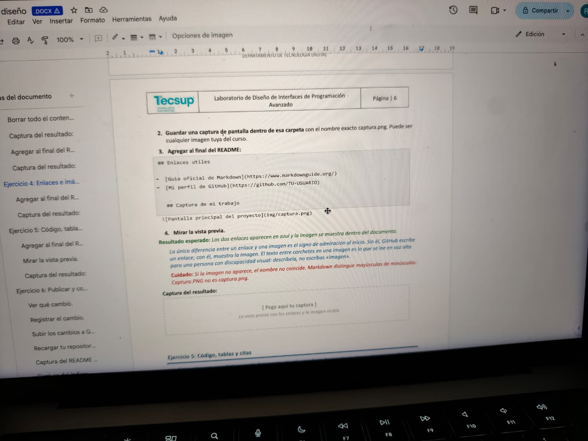

# Guía del proyecto Mi Portafolio

## 1. Descripción del proyecto

Este proyecto corresponde a mi portafolio personal, donde puedo presentar información sobre mí, mis conocimientos y los trabajos que realizo durante mi formación en Desarrollo y Diseño de Software.

La documentación sirve para conocer la estructura del proyecto y los comandos básicos para trabajar con sus archivos.

### Objetivo de la guía

Explicar cómo organizar, revisar y publicar los archivos del proyecto utilizando Visual Studio Code y Git.

## 2. Archivos y comandos del proyecto

Los siguientes archivos y comandos ayudan a mantener organizado el portafolio.

- `README.md`: contiene la presentación principal del proyecto.
- `docs/GUIA.md`: contiene esta documentación.
- `img/captura.png`: almacena una imagen del proyecto.
- `git status`: permite revisar los cambios realizados.
- `git push`: permite publicar los cambios en GitHub.

| Archivo o comando | Descripción | Uso |
|---|---|---|
| `README.md` | Presentación principal | Describe el proyecto |
| `docs/GUIA.md` | Guía de uso | Documenta el proyecto |
| `img/captura.png` | Imagen del proyecto | Muestra una captura |
| `git status` | Consulta el estado de Git | Revisa los cambios |

## 3. Instalación y uso

Para trabajar con el proyecto, sigue estos pasos en la terminal.

1. Clona el repositorio desde GitHub.
2. Entra a la carpeta del proyecto con `cd mi-portafolio`.
3. Abre la carpeta en Visual Studio Code.
4. Revisa los archivos y realiza las modificaciones necesarias.
5. Guarda los cambios y publícalos en GitHub.

### Comandos básicos

Utiliza los siguientes comandos desde la terminal:

```bash
git status
git add .
git commit -m "Actualiza la documentación"
git push origin main
```

El comando `git status` permite comprobar qué archivos han cambiado antes de preparar y publicar los cambios.

## 4. Lista de verificación

Estas tareas permiten comprobar el avance de la documentación.

- [x] Crear la carpeta `docs`.
- [x] Elaborar la guía en formato Markdown.
- [ ] Agregar y comprobar la imagen del proyecto.
- [ ] Enlazar la guía desde el README principal.
- [ ] Publicar los cambios mediante dos commits y sus respectivos push.

## 5. Recursos e imagen del proyecto

Puedes consultar la documentación oficial de Git para aprender más sobre el control de versiones: [Documentación oficial de Git](https://git-scm.com/doc).

La siguiente imagen corresponde a una captura del proyecto guardada dentro de la carpeta `img`.


